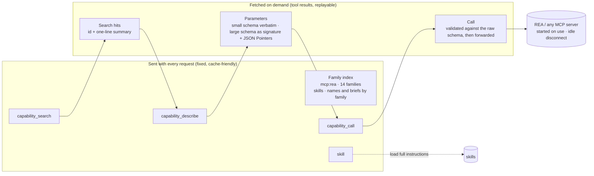

<div align="center">


# Capability Catalog

**Let DeepSeek Harness know which tools and skills exist,<br>without sending every definition on every request.**

[](https://www.npmjs.com/package/@kirkchinese/dsh-capability-catalog)
[](https://github.com/deepseek-ai/deepseek-harness)
[](#install)
[](LICENSE)

[中文](README.md) · English

[Why](#why) · [How it works](#how-it-works) · [UI](#ui) · [Install](#install) · [Configure](#configure) · [Measurements](#measurements) · [Comparison](#comparison) · [Roadmap](#roadmap) · [FAQ](#faq)

</div>

---

## Why

DeepSeek Harness (DSH) sends **the full JSON Schema of every visible tool** with **every** model request. With large tool sets that cost is hard to miss:

- The reverse-engineering MCP server [REA](https://github.com/morluto/rea) exposes 207 tools with about 668 KB of input schemas. Registered directly, **the first request of every session carries about 250k input tokens**.
- Skill catalogs have the same shape: every description is sent in every session, and any change re-sends the whole list.
- DSH's Code Mode (PTC) swaps schemas for SDK text of similar size, and mid-conversation tool additions currently break sessions on the official DeepSeek endpoint with a permanent 400.

Capability Catalog keeps **only a few-KB family index in context** and fetches definitions when they are actually needed.

<p align="center"></p>

## How it works



1. **Standing index.** One `## Capability catalog` section lists each source's families with counts and representative names. The model knows *what exists* without seeing parameters. For a given configuration the index is byte-identical, so the prompt cache holds.
2. **Three fixed tools.** `capability_search` ranks entries (BM25, snake_case splitting, CJK bigrams) or browses one family; `capability_describe` returns the description and parameters — schemas over 6 KB come back as a compact signature whose collapsed parts name a JSON Pointer that `path` expands; `capability_call` validates arguments against the raw schema with field paths in the error, then forwards to MCP.
3. **The tool array never changes.** No mid-conversation tool additions, so the endpoint's 400 failure never applies.
4. **MCP on demand.** Tool lists are cached on disk, so Harness startup does not launch servers; only `capability_call` connects; idle connections close after 5 minutes.
5. **Skill catalog takeover.** The native catalog no longer repeats every description per session; the index lists names and briefs by family. The `skill` tool and `/name` keep working.

## Highlights

| | |
| --- | --- |
| 🗂️ **One catalog, many sources** | MCP tools and skills share one index, search and switch set; plugin tools and subagent presets can follow |
| 🎚️ **Per-session switches** | Every MCP server and every skill can be switched globally and per session; the session wins |
| 🧭 **Knows what exists** | The index is organized by family, curated families carry a one-line description, and a `family` declared in tool `_meta` is used directly |
| 🔍 **Sliceable large schemas** | A 166 KB schema starts as an ~8 KB signature; expand one branch by JSON Pointer |
| ✅ **Validated before calling** | Ajv against the raw schema (JSON Schema 2020-12), errors with paths so the model can fix its call |
| 💤 **Start on use, idle disconnect** | Disk-cached tool lists; timed-out handshakes clean up the child; DSH's credential scrubbing for child environments |
| 🧊 **Cache-friendly** | The tool array is constant for the session; the index only changes with catalog content |
| 🖥️ **Native UI** | Settings card on the Plugins page and a Capabilities button beside the composer, styled only with DSH theme tokens |

## UI

<table>
<tr>
<td width="50%"></td>
<td width="50%"></td>
</tr>
<tr>
<td colspan="2" align="center"><sub><b>Plugins → the bundle page</b>: index size, MCP server status and switches, skills grouped by family (search · on/off filter · all on/off per family). Global, applied immediately.</sub></td>
</tr>
</table>

<p align="center"></p>
<p align="center"><sub><b>Capabilities button left of the composer</b>: this session only, each entry Default / On / Off, with a badge counting what is off.</sub></p>

Precedence: **session › global › configuration default**. A switched-off capability leaves the index, search and calls; a direct call is told it is switched off for this session. A server switched off globally does not start at launch; a session that switches it on discovers and runs it for that session only. Switches live in `$DSH_HOME/capability-catalog/toggles.json`, never in session logs.

## Install

Requires DSH `0.2.1-rc.2` (npm `latest`) or `0.2.1-rc.3`, Node.js `^22.19.0 || >=24.0.0`.

**Kit** (catalog + REA in one step):

```sh
npm install -g rea-agents            # puts `rea` on PATH
dsh plugin --profile web add @kirkchinese/dsh-re-kit
```

**Catalog only**, for your own MCP servers:

```sh
dsh plugin --profile web add @kirkchinese/dsh-capability-catalog
```

The settings card appears on the Plugins page and the Capabilities button appears beside the composer. Refresh a page that was already open.

| Package | Purpose |
| --- | --- |
| [`@kirkchinese/dsh-capability-catalog`](packages/capability-catalog) | The catalog plugin |
| [`@kirkchinese/dsh-rea`](packages/rea) | REA adapter: 14 curated families covering all 207 tools of REA 6.7.0. Deprecated once upstream declares families |
| [`@kirkchinese/dsh-re-kit`](packages/re-kit) | Both of the above. Install either the kit or the separate packages, not both |

## Configure

Override the `capability-catalog` row in the profile's `cordis.patch.yml` (an override replaces the whole `config`):

```yaml
- id: capability-catalog
  config:
    mcp:
      - name: github
        command: npx
        args: ['-y', '@modelcontextprotocol/server-github']
        env: { GITHUB_TOKEN: !!js process.env.GITHUB_TOKEN }
        denyTools: ['*delete*']
        families:
          - { name: issues, description: Issues and comments, match: ['*issue*', '*comment*'] }
```

Or insert one row per server without touching the main row:

```yaml
- insert:
    - id: capability-catalog-github
      name: '@kirkchinese/dsh-capability-catalog/server'
      config: { name: github, command: npx, args: ['-y', '@modelcontextprotocol/server-github'] }
```

Master switch: `enabled: false` on the `capability-catalog` row registers no tools, adds no index, runs no MCP server, and restores the native skill catalog. Every option is listed in the [plugin README](packages/capability-catalog/README.md).

## Measurements

All runs used isolated DSH instances and the official DeepSeek API.

| Scenario | REA registered directly | Capability Catalog |
| --- | --- | --- |
| First-request input tokens (whole system prompt and built-in tools included) | **249,653** | **8,404** (−96.6%) |
| REA content standing in the prompt | ~668 KB of schemas | ~3 KB family index |
| Largest single schema `compare_web_captures` | 166 KB | ~8 KB signature, expanded on demand |
| Module and import analysis of a JS app with REA | ✅ | ✅ same result |
| Idle disconnect | — | 5 s configured, 4.996 s measured |

The 13-item end-to-end suite covers install and composition, a real REA run, skill takeover, argument validation, large schemas, global/session/master switches, "global off + session on + cold cache", lifecycle and handshake timeouts, light/dark UI, cross-tab refresh and host restarts, and edge cases. The two defects found in the first round (array JSON Pointers, new-session popover overflow) are fixed and re-tested in 0.1.4. The 22 unit tests include a check that every JSON Pointer generated for all 207 REA tools at depths 1/2/3 resolves.

## Comparison

| | Direct (dsh-mcp-client) | Code Mode (PTC) | dsh-mcp-lens / progressive-tools | **Capability Catalog** |
| --- | --- | --- | --- | --- |
| Every schema in every request | yes | as SDK text, similar size | no | **no** |
| Model knows what exists | yes (all of it) | yes (all of it) | must search first | **standing family index** |
| Tool array stable in a session | yes | yes | yes | **yes** |
| Skill catalog | native, full | native, full | n/a | **unified index + switches** |
| Large schemas | full | full | full on request | **signature + Pointer expansion** |
| Switches and UI | — | — | config file | **global + session, native UI** |
| Targets DSH 0.2.x | ✅ | ✅ | still 0.1.x as of 2026-10-23 | ✅ |

## Roadmap

- [x] MCP and skill sources, one index, global and per-session switches, settings UI
- [ ] **Native deferred mode.** The official DeepSeek endpoint already accepts `defer_loading` tools and `tool_reference` blocks in tool results (deferred tools cost no input tokens and the model calls them natively). Enabled once the DSH adapter supports it — proposal: [deepseek-harness#10812](https://github.com/deepseek-ai/deepseek-harness/discussions/10812)
- [ ] Retire the curated rules in `dsh-rea` once REA declares families in `tools/list` — proposal: [morluto/rea#6870](https://github.com/morluto/rea/issues/6870)
- [ ] More sources: plugin tools, subagent presets
- [ ] Optional hybrid retrieval (keywords + embeddings)

## FAQ

<details>
<summary><b>Doesn't the extra search step slow the model down?</b></summary>

It adds one or two tool calls and removes hundreds of thousands of tokens from every request while keeping the prompt cache stable. In practice the model searches once, describes once, and calls correctly; wrong arguments come back with field paths it fixes on the next step. For a handful of tools used on every turn, direct registration remains simpler.
</details>

<details>
<summary><b>An older session shows "no skills are available"?</b></summary>

That is the native skill plugin's empty-catalog notice after its tool is shadowed. The index states that it replaces the separate skill list, and the model loads skills through the `skill` tool as listed there.
</details>

<details>
<summary><b>I edited toggles.json by hand and nothing changed.</b></summary>

The file is read at startup. Use the settings card or the Capabilities button, which apply immediately; hand edits need a Harness restart.
</details>

<details>
<summary><b>What is the approval granularity?</b></summary>

`capability_call` is an ordinary DSH tool and goes through DSH approvals as one tool name, not per MCP tool. Use `allowTools` / `denyTools` or switches to narrow what is reachable.
</details>

## Development

```sh
pnpm install
pnpm test                                 # build and run the 22 unit tests
node scripts/sync-patches.mjs             # generate patches from packages/rea/families.yml
node scripts/pack-local.mjs /tmp/packs    # local tarballs for isolated-instance testing
```

Design notes: [docs/design.zh.md](docs/design.zh.md) · Upstream proposals: [docs/upstream/](docs/upstream/)

## License

[MIT](LICENSE) © kirkchinese
