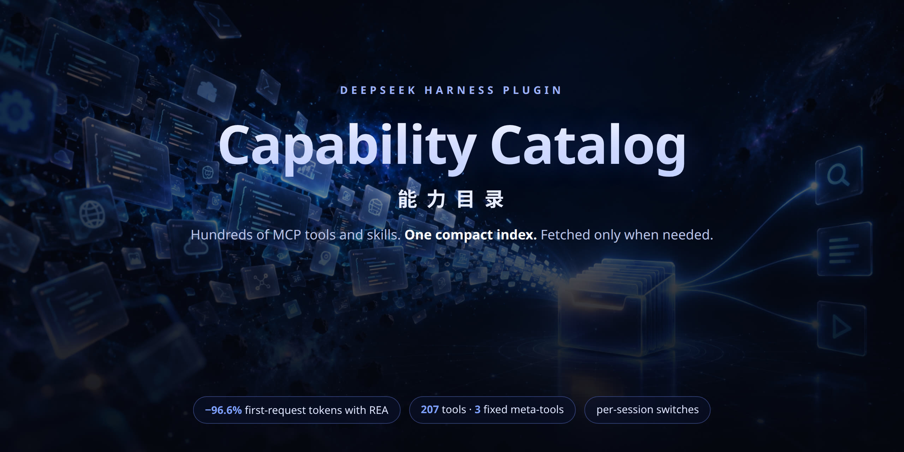
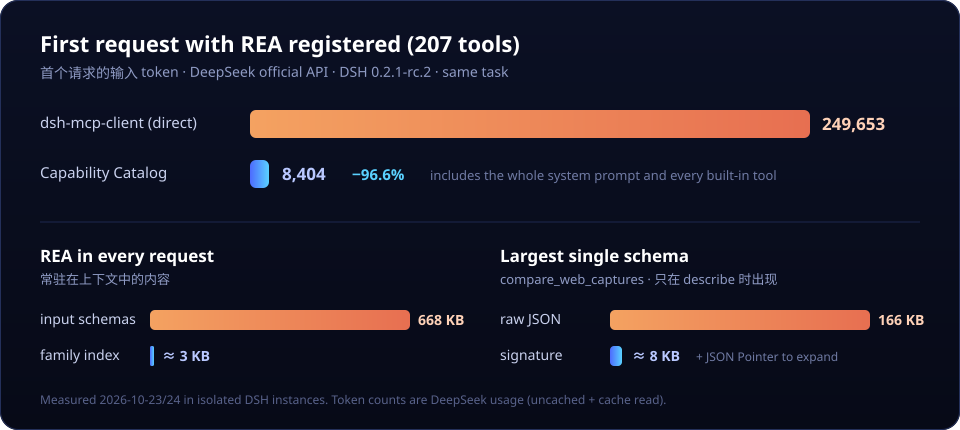
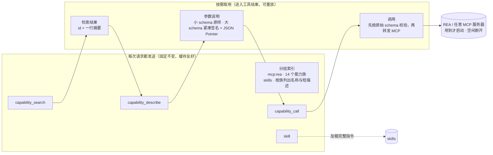
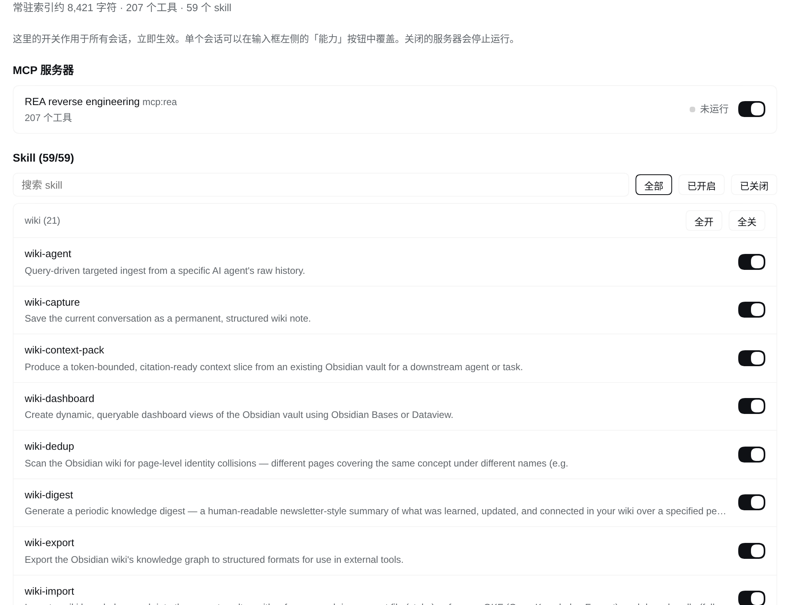
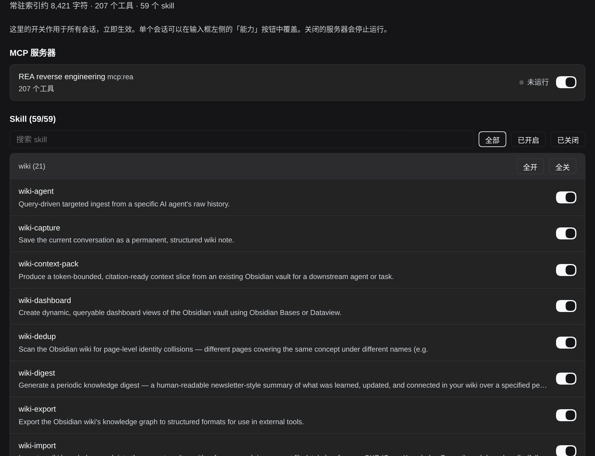
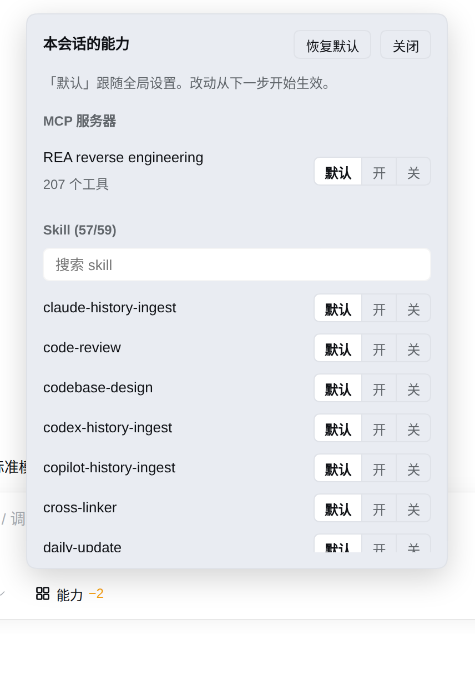

<div align="center">



# 能力目录 · Capability Catalog

**让 DeepSeek Harness 知道有哪些工具和 skill，<br>却不必把它们的全部定义塞进每一次请求。**

[](https://www.npmjs.com/package/@kirkchinese/dsh-capability-catalog)
[](https://github.com/deepseek-ai/deepseek-harness)
[](#安装)
[](LICENSE)

中文 · [English](README.en.md)

[为什么需要](#为什么需要) · [工作原理](#工作原理) · [界面](#界面) · [安装](#安装) · [配置](#配置) · [实测](#实测) · [对比](#和其他方案对比) · [路线图](#路线图) · [常见问题](#常见问题)

</div>

---

## 为什么需要

DeepSeek Harness（DSH）会把**每个可见工具的完整 JSON Schema** 放进**每一次**模型请求。工具一多，代价就很直观：

- 接入逆向工程 MCP 服务器 [REA](https://github.com/morluto/rea)：207 个工具、约 668 KB 参数定义，**每个会话的第一个请求就要多带约 25 万输入 token**；
- skill 目录是同类问题：几十个 skill 的描述每个会话都要发一遍，目录一变还要整份重发；
- DSH 自带的 Code Mode（PTC）只是把 schema 换成 SDK 文本，体积不变；会话中途追加工具的机制，目前在 DeepSeek 官方端点上会让会话永久 400。

能力目录换一种做法：**常驻在上下文里的只有一份几 KB 的分组索引，具体定义在用到时才取。**

<p align="center"><a href="https://github.com/kirkchinese/dsh-capability-catalog/releases/download/v0.1.4/capability-catalog-promo.mp4"></a></p>
<p align="center"><sub>🎬 60 秒宣传片（1080p）· 点击图片观看</sub></p>

<p align="center"></p>

## 工作原理



1. **常驻索引**：系统提示里只有一段 `## Capability catalog`，列出每个来源有哪些能力族、各有多少条目和代表名称。模型知道“有什么”，但看不到参数。同一配置下索引逐字节不变，前缀缓存不会失效。
2. **三个固定工具**：`capability_search` 检索（BM25，拆分 snake_case，中文二元组）或按族浏览；`capability_describe` 给出完整说明和参数——超过 6 KB 的 schema 先给紧凑签名，折叠处标出 JSON Pointer，用 `path` 展开；`capability_call` 用原始 schema 校验参数，错误带字段路径，再转发给 MCP。
3. **工具列表从不变化**：不依赖会话中途追加工具，也就避开了 DeepSeek 端点上的 400 问题。
4. **MCP 按需运行**：工具清单缓存在磁盘上，启动 DSH 时不拉起服务器；只有 `capability_call` 才连接；空闲 5 分钟自动断开。
5. **接管 skill 目录**：原生 skill 目录不再逐会话发送全部描述，改为在索引里按族列出名称和短描述；`skill` 工具与 `/name` 用法不变。

## 亮点

| | |
| --- | --- |
| 🗂️ **一个目录，多种来源** | MCP 工具与 skill 共用一套索引、检索与开关；后续可接入插件工具、subagent preset |
| 🎚️ **细到会话的开关** | 每个 MCP 服务器、每个 skill 都能单独开关；全局一层、会话一层，会话优先 |
| 🧭 **知道有什么** | 索引按能力族组织，人工整理的族带一句说明；服务器在 `_meta` 中声明的 `family` 会被直接采用 |
| 🔍 **超大 schema 可切片** | 166 KB 的单个 schema 先给约 8 KB 的签名，再按 JSON Pointer 展开某一支 |
| ✅ **调用前校验** | 用原始 schema（Ajv，JSON Schema 2020-12）校验，错误带路径，模型可自行修正 |
| 💤 **按需启动、空闲断开** | 磁盘缓存工具清单；握手超时会清理子进程；子进程环境沿用 DSH 的凭据清洗 |
| 🧊 **缓存友好** | 工具数组整场会话不变，索引只随目录内容变化 |
| 🖥️ **原生界面** | 插件页设置卡片 + 输入框旁「能力」按钮，只用 DSH 主题变量，浅色深色都自然 |

## 界面

<table>
<tr>
<td width="50%"></td>
<td width="50%"></td>
</tr>
<tr>
<td colspan="2" align="center"><sub><b>插件 → 逆向工具整合包</b>：常驻索引大小、MCP 服务器运行状态与开关、按族分组的 skill 开关（搜索 · 开/关筛选 · 每族全开/全关）。全局生效、立即生效。</sub></td>
</tr>
</table>

<p align="center"></p>
<p align="center"><sub><b>输入框左侧「能力」按钮</b>：只作用于当前会话，每项「默认 / 开 / 关」，按钮徽标显示本会话关闭了几项。</sub></p>

生效顺序：**会话设置 › 全局设置 › 配置文件默认值**。关掉的能力会从索引、检索与调用中一并移除，模型直接调用时会得到“已在本会话关闭”的提示。全局关掉的服务器不在启动时运行；某个会话单独打开它时，只为该会话按需发现和启动。开关存于 `$DSH_HOME/capability-catalog/toggles.json`，不写入会话日志。

## 安装

要求：DSH `0.2.1-rc.2`（npm `latest`）或 `0.2.1-rc.3`，Node.js `^22.19.0 || >=24.0.0`。

**整合包**（能力目录 + REA，一步到位）：

```sh
npm install -g rea-agents            # 让 `rea` 出现在 PATH 上
dsh plugin --profile web add @kirkchinese/dsh-re-kit
```

**只装能力目录**，接入自己的 MCP 服务器：

```sh
dsh plugin --profile web add @kirkchinese/dsh-capability-catalog
```

装完后在「插件」页即可看到设置卡片，新会话的输入框左侧会出现「能力」按钮。已经开着的页面如果没出现，刷新一次。

| 包 | 作用 |
| --- | --- |
| [`@kirkchinese/dsh-capability-catalog`](packages/capability-catalog) | 通用能力目录插件（核心） |
| [`@kirkchinese/dsh-rea`](packages/rea) | REA 适配：14 个人工整理的能力族，覆盖 REA 6.7.0 全部 207 个工具。上游支持后弃用 |
| [`@kirkchinese/dsh-re-kit`](packages/re-kit) | 整合包：上面两者一起装。与前两者二选一，不要重复安装 |

## 配置

在 profile 的 `cordis.patch.yml` 里覆盖 `capability-catalog` 行（覆盖会替换整个 `config`）：

```yaml
- id: capability-catalog
  config:
    mcp:
      - name: github
        command: npx
        args: ['-y', '@modelcontextprotocol/server-github']
        env: { GITHUB_TOKEN: !!js process.env.GITHUB_TOKEN }
        denyTools: ['*delete*']
        families:
          - { name: issues, description: 议题与评论, match: ['*issue*', '*comment*'] }
```

也可以**各插入一行**来添加服务器，互不覆盖主配置：

```yaml
- insert:
    - id: capability-catalog-github
      name: '@kirkchinese/dsh-capability-catalog/server'
      config: { name: github, command: npx, args: ['-y', '@modelcontextprotocol/server-github'] }
```

总开关：`capability-catalog` 行的 `enabled: false`。此时不注册工具、不进索引、不运行任何 MCP 服务器，原生 skill 目录恢复。全部配置项见[插件说明](packages/capability-catalog/README.md)。

## 实测

全部在隔离的 DSH 实例中用 DeepSeek 官方 API 完成。

| 场景 | 直接注册 REA | 能力目录 |
| --- | --- | --- |
| 首个请求输入 token（含全部系统提示与内置工具） | **249,653** | **8,404**（−96.6%） |
| REA 在提示中的常驻内容 | 约 668 KB schema | 约 3 KB 分组索引 |
| 最大单个 schema `compare_web_captures` | 166 KB | 约 8 KB 签名，按需展开 |
| 用 REA 分析一个 JS 项目的模块与 import | ✅ | ✅ 结果一致 |
| 空闲断开 | — | 设定 5 s，实测 4.996 s 退出 |

端到端测试 13 项：安装与组合、REA 实跑、skill 接管、参数校验、超大 schema、全局/会话/总开关、“全局关 + 会话开 + 冷缓存”、生命周期与握手超时、Web 界面浅深色、跨页刷新与主机重启、边界情况。首轮发现的两个缺陷（数组字段的 JSON Pointer、新会话弹窗越界）已在 0.1.4 修复并复测。单元测试 22 项，其中一项检查“REA 全部 207 个工具在折叠深度 1/2/3 下生成的每个 JSON Pointer 都能解析”。

## 和其他方案对比

| | 直接注册（dsh-mcp-client） | Code Mode（PTC） | dsh-mcp-lens / progressive-tools | **能力目录** |
| --- | --- | --- | --- | --- |
| 每次请求都带全部 schema | 是 | 换成 SDK 文本，体积相近 | 否 | **否** |
| 模型知道有哪些能力 | 是（全量） | 是（全量） | 要先搜索 | **分组索引常驻** |
| 工具列表会话中不变 | 是 | 是 | 是 | **是** |
| skill 目录 | 原生全量 | 原生全量 | 不涉及 | **统一索引 + 开关** |
| 超大 schema | 全量 | 全量 | 全量返回 | **签名 + Pointer 展开** |
| 开关与界面 | — | — | 配置文件 | **全局 + 会话，原生界面** |
| 适配 DSH 0.2.x | ✅ | ✅ | 截至 2026-10-23 仍面向 0.1.x | ✅ |

## 路线图

- [x] MCP 与 skill 两种来源、统一索引、全局/会话开关、设置界面
- [ ] **原生延迟加载模式**：DeepSeek 官方端点已实测支持 `defer_loading` 工具与工具结果中的 `tool_reference`（延迟工具不计输入 token，模型可直接原生调用）。等 DSH 适配器支持后启用，提案见 [deepseek-harness#10812](https://github.com/deepseek-ai/deepseek-harness/discussions/10812)
- [ ] REA 在 `tools/list` 中声明能力族后弃用 `dsh-rea` 的人工规则，提案见 [morluto/rea#6870](https://github.com/morluto/rea/issues/6870)
- [ ] 接入更多来源：插件工具、subagent preset
- [ ] 可选的混合检索（关键词 + 向量）

## 常见问题

<details>
<summary><b>多了一步检索，会不会变慢、变笨？</b></summary>

会多一到两次工具调用，换来的是每次请求少掉几十万 token，前缀缓存也稳定。实测中模型通常一次检索、一次查看参数后就能正确调用；参数错了插件会给出字段路径，模型据此修正。对每轮都要用的少数几个工具，直接注册仍然更简单。
</details>

<details>
<summary><b>旧会话里出现“没有可用 skill”的提示？</b></summary>

这是 DSH 原生 skill 插件发现自己的工具被替换后追加的“清空目录”提示。索引里有一句说明 skill 以能力目录为准，模型会按索引使用 `skill` 工具。
</details>

<details>
<summary><b>直接改了 toggles.json 没生效？</b></summary>

插件只在启动时读取这个文件。请通过设置卡片或「能力」按钮修改，立即生效；手改文件要重启 DSH。
</details>

<details>
<summary><b>中文检索搜不到英文工具？</b></summary>

检索是关键词匹配（BM25），不做跨语言语义理解。索引里的族名和说明是英文，模型通常会用英文关键词检索；也可以用 `family` 直接浏览一整族。
</details>

<details>
<summary><b>审批粒度是怎样的？</b></summary>

`capability_call` 是一个普通 DSH 工具，照常经过 DSH 的审批流程，审批粒度是这一个工具名，而不是每个 MCP 工具。需要更细的控制时，用 `allowTools` / `denyTools` 或开关限制可见范围。
</details>

## 开发

```sh
pnpm install
pnpm test                                 # 编译并运行 22 项单元测试
node scripts/sync-patches.mjs             # 由 packages/rea/families.yml 生成各包 patch
node scripts/pack-local.mjs /tmp/packs    # 打包本地 tarball，用于隔离实例测试
```

设计文档：[docs/design.zh.md](docs/design.zh.md) · 上游提案：[docs/upstream/](docs/upstream/)

## 许可证

[MIT](LICENSE) © kirkchinese
